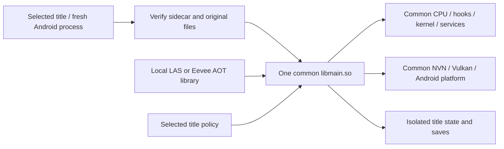

# Shared Android runtime integration

Implemented and exercised on Thor, 2026-10-25. One Android `libmain.so` contains
the common CPU/dispatch, NSO loader, kernel/services, platform, NVN/Vulkan
backend and both title policies. New LAS and Eevee libraries compile against it,
and actual fresh-process sessions verified identical loaded runtime bytes.
The owner reports shared Eevee running fine; LAS reaches outdoor gameplay with
complete BowWow rendering and owner-confirmed water transparency. Remaining
[graphics qualification](shared-las-graphics.md), full reference routes,
controls/audio/save acceptance, lifecycle reliability and efficiency comparisons
remain open.

The separate `com.recomp.shared.test` app now has a native library launcher,
extracted-folder import, a foreground compiler service in `:build`, and SDL games
in fresh `:game` processes. The owner explicitly authorized interruption for this
work. Original reference installations, settings and saves remain preserved.



## Implemented behavior

`tools/build_shared_android.py` stages the pinned LAS Android source into a
separate owned directory and applies the reviewed shared overlays. It builds
offline against the existing SDL/AdrenoTools/shaderc cache and isolated
Opus-enabled FFmpeg build. There is no title-specific runtime compile flag or
second selectable renderer. The export map exposes measured generated-code
imports, explicit core APIs and required Android JNI entrypoints while keeping
other implementation symbols local.

Runtime addresses come from the immutable selected layout. LAS keeps its shifted
window; Eevee keeps the unshifted window already observed on Thor. The setup gate
checks independent expectations, selects the layout and safely reserves the
window before `dlopen`. Failure consumes the process after successful preflight;
switching titles or retrying a load requires a fresh process.

The common NSO loader hashes and decodes all selected images, checks bounded
MOD0/dynamic/symbol/string/RELA metadata and resolves all relocations in owned
staging buffers before copying any image to guest memory. Initializer targets
must exist in the validated generated tables. Unsupported formats, unknown
strong imports and invalid segment ordering fail explicitly. Defined guest
symbols, HLE imports, other modules and weak-zero resolution preserve the
selected policy. The adapter separately names early SDK/subsdk and late main
initialization; both initial SDK signatures use four arguments.

CPU lifecycle registration is synchronized for runtime-created guest threads.
HLE procedure registration supports concurrent NVN lookups with immutable
published addresses and atomic function pointers. Dispatch cache hits retain the
LAS per-CPU fast path. The HLE safe-point callback allows orderly guest-thread
cancellation; hook/override configuration still requires quiescent execution.

Common services retain LAS's filesystem journal, audio mixer and protocol
implementations. Required Eevee differences include native Opus, audio queue
policy, handheld input, virtual mouse gyro/touch/gestures and movie handling.
The common movie implementation supports raw-image AVIO, the guest frame
allocator, tight NV12 output and EOF behavior while preserving LAS's aligned
output and movie-specific behavior. Unimplemented movie vtable slots fail when
called rather than returning fabricated success.

LAS gameplay callbacks are gated in shared input/render/UI paths. Eevee does not
run LAS save editors, randomizer patches, inventory readers or camera-address
helpers. Per-title working directories isolate settings, shader caches and
journaled saves; guest filesystem paths cannot traverse into sibling title
directories. Shared user fonts resolve from the app resource root. Extracted
RomFS directories use generic layout detection rather than LAS's directory name;
raw images remain supported.

The shared Vulkan backend retains LAS's import/writable-mirror path and adds
uint32 low/high guest-address arithmetic for writable mirrors without shaderInt64.
Drivers whose storage-buffer range is below64MiB use the bounded read-only
snapshot path and reject stores explicitly. Swapchain storage/checks support all
returned images up to32. LAS Android's event polling/4ms idle sleep remains in
the common UI loop, retaining the fix for Eevee's measured full-core UI spin.

## New private title producers

`tools/build_shared_gamelib.py` verifies original NSO hashes/full build IDs
against the independent input records. It preserves each title's generated
shift, ARM64 SIMD and required hook profile, compiling against the common CPU3.
Both outputs export only the data object `recomp_module_descriptor_v1`; legacy
getters are not used for execution.

| Producer | Generation evidence | Objects | Runtime |
| --- | --- | --- | --- |
| LAS | Fresh serial generation into a new namespace;772 C units,86,669 main and34,982 SDK functions |773 including entry | Same common artifact |
| Eevee | All972 C hashes match the completed generation manifest;60,380/31,906/17,984/13,342 functions |973 including entry | Same common artifact |

All1,746 objects compiled in the new caches. LAS preserves its O2/split/cold
policy; Eevee preserves O1 and the reviewed per-unit optimizer mitigations.
Subsequent runtime-only corrections reused all objects and relinked both
libraries. No reference objects or generated code were overwritten.

The binary sidecar has an exact versioned little-endian schema:176-byte header
plus112 bytes per module (400 bytes for LAS,624 for Eevee). It binds runtime
contract, CPU/SIMD/hook profile, generated-code identity, final library SHA-256
and full original-module metadata. Runtime checks compare its declarations to
the selected policy and hash the original files/library before loading. The
descriptor must belong to the verified title DSO. This is trusted local code
loading; `dlopen` may execute host constructors, and this is not a native-code
sandbox or signature/authenticity service.

## Verification and reproduction

```sh
python3 tools/check_shared_aot.py
python3 tools/check_shared_loader.py
python3 tools/check_shared_hash.py
python3 tools/check_shared_movie.py
python3 tools/check_shared_real_images.py
python3 tools/check_shared_artifacts.py
```

- The joint component checker passes94 scenarios per optimized/sanitized host
  variant and links its Android arm64/API30 fixtures/runners. It includes
  reservation rejection, concurrent HLE/lifecycle work, manifests, path bounds,
  title selection and the8,394-check NSO decoder suite.
- The actual loader passes26 synthetic scenarios per host variant, verifying
  expected rejection diagnostics and unchanged guest memory before failure.
  Its Android runner links. Those fixtures clearly label fake HLE/SHA providers.
- The production SHA wrapper passes16 vector/file checks per host variant.
  The movie harness passes173 checks per variant, including exact Y/UV output,
  allocator behavior, AVIO bounds/lifecycle and fatal padding slots; FFmpeg
  cleanup/callback interfaces are mocked, so this is not decoder playback proof.
- The actual host loader accepts all six original NSOs in separate two-/four-
  module processes, using real file hashes and hash-verified generated address
  metadata. All mappings use `MAP_FIXED_NOREPLACE` and are non-executable.
  Strict HLE discovery uses only current source definitions:68 LAS and74 Eevee
  address stand-ins, zero audit-only providers and zero guest/stand-in calls.
  This verifies loading/relocation structure without executing ARM64 game code.
- Captured Eevee vertex/fragment shaders compile and validate as SPIR-V across
  three capability paths (six cases); read-only mode omits Int64 and rejects
  synthetic stores. No Vulkan driver/GPU executed those probes.
- Both new title ELFs pass target, SONAME,16KiB alignment, descriptor-only
  export, sidecar/hash and strong-import checks against the identical runtime.
- The game-free APK passes signature checks and preserves native library bytes.
  RootBoost remains intentionally disabled: its compiled permission query returns
  false and start/stop contain no work. This does not disable compilation: the
  optional on-device toolkit supplies real Android Python/generator/compiler tools
  through the implemented foreground build service.
  No game data, generated game code, keys or saves enter the APK.

Private source/build hashes, commands, library inventories, object manifests and
reports stay under ignored `build/`. Build the runtime/APK offline with:

```sh
python3 tools/build_shared_android.py --build --jobs 3
python3 tools/build_shared_gamelib.py --title las --generate-las --build --jobs 3
python3 tools/build_shared_gamelib.py --title eevee --build --jobs 3
python3 tools/package_shared_android.py --build --jobs 2
python3 tools/check_shared_artifacts.py
```

Use the completed generation manifests for repeated builds; valid object caches
are reused. Each tool validates its required local inputs and performs no device
actions. These private builds require the owner's already imported game files
and cached dependencies; tracked source does not contain them.

## Compilation and installation model

The runtime-only APK is approximately63.3MB compressed; the current build with
compiler tools is approximately 138.5 MB. Original assets and AOT title libraries
live separately in private app storage. Android extracts the native tools on
installation; installed storage exceeds APK size.

The host producer remains available. The new [on-device producer and toolkit](shared-ondevice-toolkit.md)
implement pinned NSO-to-C generation, ARM64 compilation, resumable objects,
strict metadata checks and atomic library/sidecar publication. Actual installed
app-UID generation and cancellation are verified. A full LAS build completed
773/773 compilation units with no object reuse in approximately 628 seconds;
its published library subsequently booted visible opening video at 30 fps, with
the actual mapped library hash verified. The full Eevee on-device build subsequently completed all 973 units,
reusing 303 verified objects and compiling 670 with four workers; execution of
that newly published library was then verified through controller confirmation and
the opening movie at 30 fps, then continued the existing save into Oak’s lab.
Both on-device-built libraries mapped identical
final runtime bytes in fresh processes. The launcher
currently imports extracted folders, not arbitrary NSP/NSZ packages or unknown games. Each additional title
still needs its own verified metadata, module layout and qualified hooks/services.
Runtime-only fixes reuse compatible game object/library artifacts.

`tools/stage_shared_manual.py --title las|eevee` stages either supported title
using read-only reference access and device-local copying. It verifies original
modules, RomFS, library, sidecar and installed APK, clones a save only into an
empty isolated namespace and preserves later test saves. It refuses protected
manual-session or running-app mutations. `--launch` opens once without scripted
input or automatic close; readable startup must be checked before owner handoff.

Initial Eevee device runs exposed and fixed SDK GetInfo20's missing exception context,
an unconditional LAS save-editor callback, NULL program unbind/stage-composition
semantics, and missing NVN interval pacing when no VI event is requested.
The common binder also supports vertex-only depth passes without reading NULL
fragment code in translation, hashing, diagnostics or head-start caches.
Host regression tools exercise actual extracted binder and interval-pacer code
under optimization and ASan/UBSan. Their mocks do not establish rendering accuracy.
Subsequent device logs report 30.0fps. A narrow graphics comparison found that
turning off scalar/aligned constant-buffer optimizations left the screen blank;
adding `LARECOMP_VK_DYN_VERTEX=0` restored the controller screen. A fresh launch
with only the static-vertex setting, normal constant-buffer optimizations and no
diagnostic options reproduced readable controller selection/confirmation at 30 fps.
The staging profile retains that setting for Thor's stock Adreno driver; it is a
verified workaround, not a diagnosis of a Vulkan driver defect. The actual mapped
`libmain.so` and game library hashes match the host/APK artifacts. Those initial
checks established Eevee startup rendering and pacing; subsequent same-runtime
sessions also reached LAS gameplay as recorded below. Eevee's unchanged LAS
speed overlay is not a valid measurement of Eevee simulation speed.

## Current acceptance and remaining checks

Install the separate test package only after the owner ends or explicitly
authorizes interruption of manual play. Stage new title code/sidecars and
separate data/state, start each title in a fresh process and verify the loaded
runtime bytes match the common APK artifact. Both titles have passed this
same-runtime startup check. Controls, text, movie/audio, transitions and
save/reload still need systematic route acceptance; later Eevee battle/capture
and GPU write behavior remain explicit qualification work.

Common-runtime gameplay has been observed for LAS, and the owner reports Eevee
running fine. This is not complete gameplay/accuracy acceptance or evidence of a
temperature or performance advantage. The owner initially reported unresponsive
physical controls and Configure inputs, then reported that they appeared to be
working; coordinator controller/touch probes also opened configuration. That
does not close physical-control or lifecycle acceptance, and no hidden input fix
is claimed. The original reference apps and saves remain unchanged. Physical
Thor gyro, network/Bluetooth communication, later GPU-store scenes and Echoes
remain unqualified. The installed app now includes title selection, extracted-folder
import, foreground compilation/cancellation and game launch; broader package
import and support for additional titles remain future work.

## Current Thor LAS profile

The old Turnip 24.3 no-Int64 path restores lighting with the writable32-bit mirror,
but still loses BowWow’s body. The owner’s installed Turnip 26.2 R5 advertises
shaderInt64 and uses the common runtime’s existing64-bit shader path normally.
BowWow renders completely at 30 fps with static vertex input and the normal render
thread. Opening video is visible after restoring `TU_DEBUG=nolrz`; the owner
confirms water transparency. See [the graphics evidence and remaining gates](shared-las-graphics.md).
The compiler-equipped normal APK is approximately 138.5 MB; optional validation
layer packaging is for diagnostics and is disabled in the normal build.
